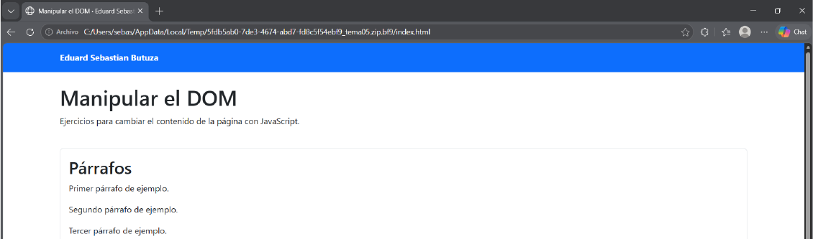
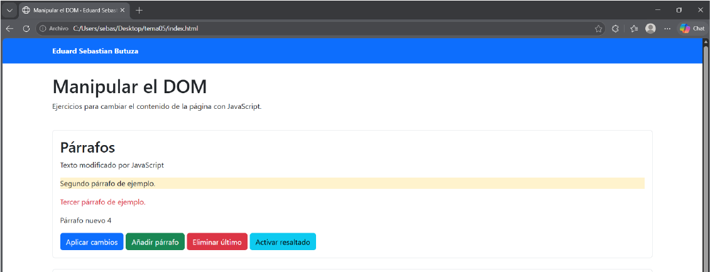
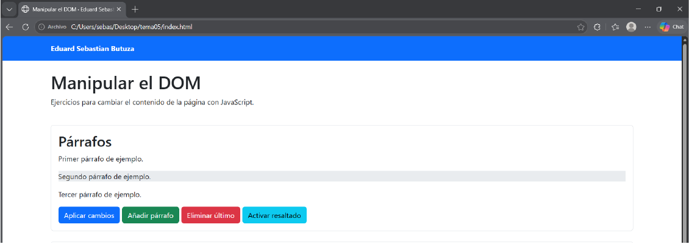
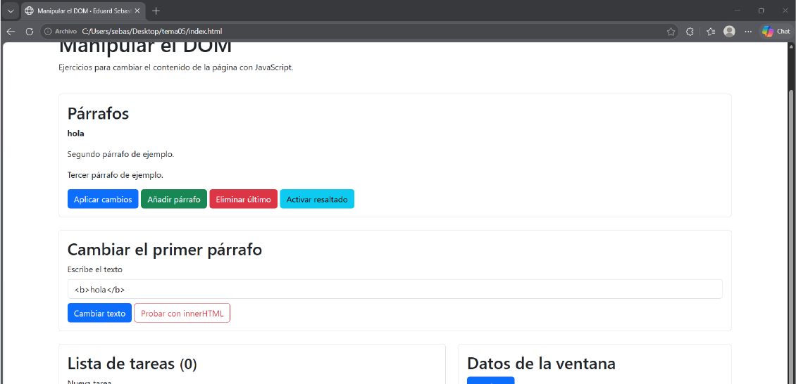
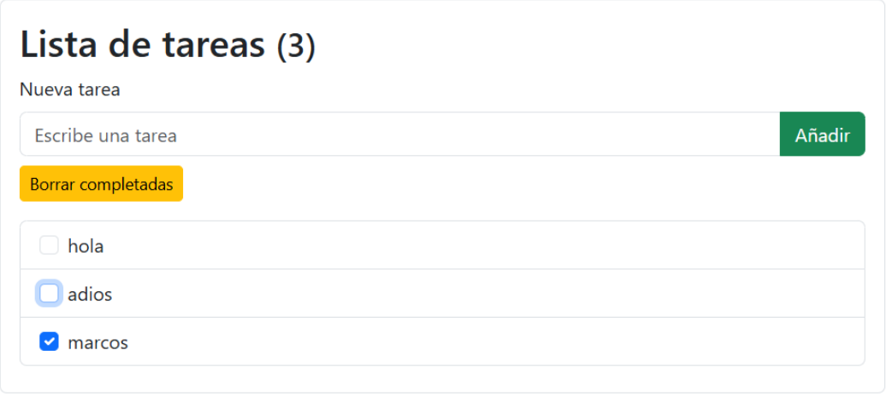
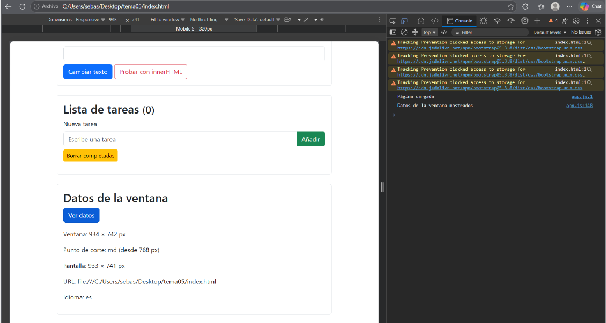

# Tarea 5 · Manipular el DOM

**Autor:** Eduard Sebastian Butuza · Desarrollo Web en Entorno Cliente (DWEC) · 2.º DAW · Curso 2026-27

En esta práctica he usado JavaScript para seleccionar elementos de la página y cambiar su contenido o aspecto. También he creado y eliminado párrafos, añadido tareas a una lista y consultado datos del navegador.

## Capturas

### a) Página recién cargada

Se ven el título, mi nombre y los tres párrafos iniciales.

### b) Ejercicios 1 y 2

El primer texto ha cambiado, el segundo está resaltado, el tercero aparece en rojo y he añadido un párrafo.

### c) Ejercicio 3: resaltado

Al pasar el ratón por el segundo párrafo, cambia su fondo.

### d) Ejercicio 4: innerHTML

He escrito `<b>hola</b>` y la página muestra «hola» en negrita.

### e) Ejercicio 5: lista de tareas

He añadido tres tareas y he marcado una antes de borrarla.

### f) Ejercicio 6: datos de la ventana

La tabla muestra los datos que aparecen al pulsar «Ver datos».

## Reflexión

Con `textContent`, el navegador muestra `<b>hola</b>` como texto normal, incluidas las etiquetas. Con `innerHTML`, interpreta las etiquetas HTML y por eso «hola» aparece en negrita. `innerHTML` puede ser peligroso si se usa con texto que escribe una persona, porque el navegador podría interpretar contenido HTML no deseado. Para mostrar texto normal, es más seguro usar `textContent`.

## Fuentes

- [Plantilla de la tarea 5](https://github.com/DRodero/DWEC_2627/tree/main/tema05_plantilla)
- [MDN: Node.textContent](https://developer.mozilla.org/es/docs/Web/API/Node/textContent)
- [MDN: Element.innerHTML](https://developer.mozilla.org/es/docs/Web/API/Element/innerHTML)

## Uso de IA

He utilizado ChatGPT para preparar una primera versión del JavaScript y organizar este README. Después he probado las funciones de la página y revisado qué hace cada una.
